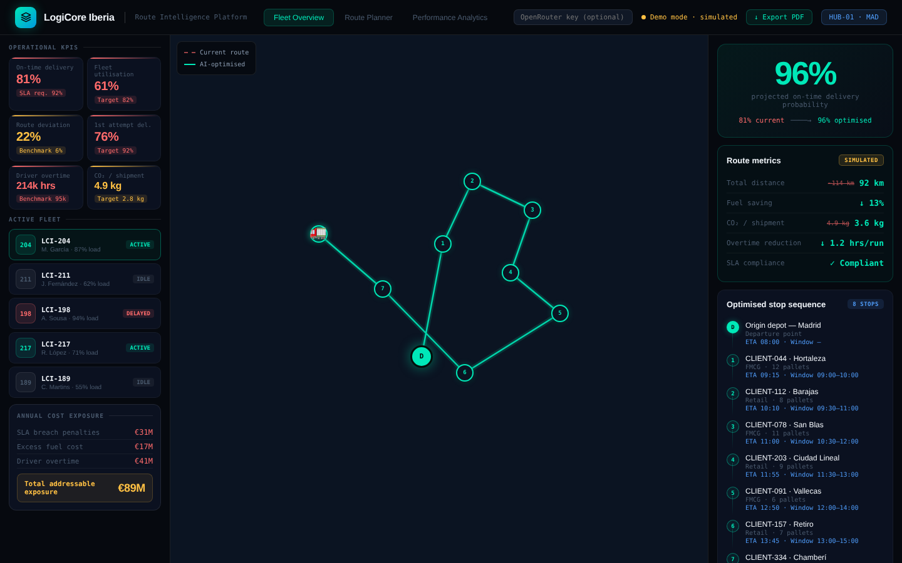

# LogiCore Iberia · AI Route Intelligence

A proof of concept for a Madrid logistics operator that is missing its delivery targets. It shows where the money is being lost and uses an LLM to re-plan a delivery route around the priority the planner chooses.

## The problem

LogiCore's on-time delivery rate is 81% against a contractual SLA of 92%. Fleet utilisation is 61%, and driver overtime is more than double the industry benchmark. Together that adds up to around €89M a year in penalties, excess fuel and overtime, and three top-10 clients are reviewing their contracts.

## What it does

- **Fleet overview:** operational KPIs against targets, active vehicles, annual cost exposure and the clients currently breaching their SLA.
- **AI route optimisation:** pick a depot, delivery zone, vehicle and priority (SLA first, fuel saving or speed). The model re-sequences the stops and returns projected on-time probability, distance, fuel and CO₂ savings, overtime reduction and a short explanation of its reasoning and risks.
- **Map:** compares the current route with the optimised one, using real road geometry from OSRM.
- **Route planner and PDF report:** schedule a run and export the optimisation as a one-page report.

## Try it

Open `index.html` in a browser.

- **Demo mode (default):** without an API key, the optimisation returns a pre-written result for each priority, labelled **Simulated**.
- **Live mode:** paste an [OpenRouter](https://openrouter.ai) key into the field in the header. The key stays in that tab only.

## Built with

HTML, CSS, vanilla JavaScript · Claude Sonnet 4 via the OpenRouter API · Leaflet + OpenStreetMap · OSRM routing API

## Notes

LogiCore Iberia, its clients and all figures are fictional and were created for a university case study.
